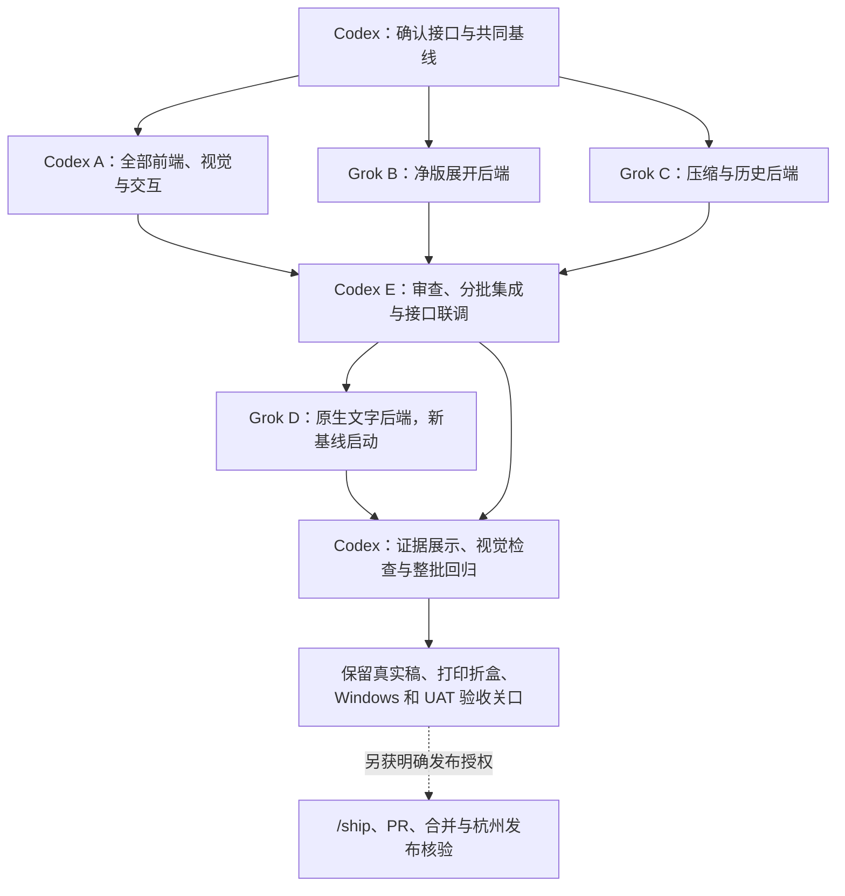

# Codex 前端 / Grok 后端并行交接合同 v2

2026-10-09。用户确认视觉、交互和全部前端由 Codex 负责，后端提示词由用户交给 Grok 执行，Codex 同时负责公共接口、审查、集成与收尾。此 v2 替代原 A/B/C 按功能全栈分工，旧提示词停止派发。本文件只细化任务边界，不改变[最终执行方案](2026-10-09-r05-r07-final-execution-plan.md)的五项范围；当前状态仍只维护在 [TODOS](../../TODOS.md)。

## 基线与权限

- 集成分支：`codex/r05-r07-autoplan`。各工作树从同一份包含方案及本文件的本地基线提交建立，准确 SHA 由交接提示词提供。
- 开工时检查 pwd、branch、HEAD、status、祖先关系及本目录 AGENTS。只能在分配工作树修改。其他工作树、原用户目录、生产数据及真实稿只读限制不能被本提示词绕过。
- 本次范围为本地实施、相关合成测试、按文件名提交功能改动和主 agent 本地集成。Grok 不推送、不创建 PR、不合 main、不运行发布、不调用外部消息或真实 OCR/Illustrator/Blender，不重新执行 autoplan。
- 用户保留“先不验证”针对真实稿压缩/质量、原生软件和现场验收；代码开发须做必要的本地合成行为测试，并如实报告环境缺失。不能把用户原 PDF 当合成夹具，更不能上传公共服务。
- 不改 VERSION/CHANGELOG、质量基线、CI/发布脚本、AGENTS、技能或全局工具配置；新增依赖只在自己的工作树锁定并记录许可，不作全局安装或生产接入。已有依赖可按锁文件在独立目录安装，不共享可写 node_modules、dist 或测试数据目录。
- 没有仓库/终端能力的普通聊天模型应明确不能执行，不得编造修改、提交 SHA 或通过的测试。

## 第一波与第二波

| 任务 | 执行者 / 分支 | 主责 |
|---|---|---|
| A：全部前端与视觉 | Codex / `codex/review-sidebar`（沿用已建名称） | B01.4 完整 UI；R05 展开/六面 UI；R06 压缩 UI；R07 历史 UI；B01.5 证据展示；UI API 客户端、路由、样式及交互测试 |
| B：R05 后端 | Grok / `codex/unfolded-print` | 完整净版导出、尺寸与几何校验、打样资产/下载、既有 Illustrator 宿主适配及后端测试 |
| C：R06/R07 后端 | Grok / `codex/compression-history` | 压缩执行、上传/队列/恢复/资源、统一历史摘要查询、权限、下载及后端测试 |
| D：B01.5 后端（第二波） | Grok / `codex/native-text-review`（待创建） | B/C 公共能力集成后，从新基线做原生候选与 OCR 融合 |
| E：接口协调与集成 | Codex 主 agent / `codex/r05-r07-autoplan` | 接口冻结/变更决策、审查/组合回归、公共文档、第二波启动和整批收口 |

第一波为 Codex A 与 Grok B/C 三条线并行。Codex 同一个主 agent 在自己的前端工作树实现，再返回集成工作树收尾，不自动另开 Codex 任务或子 agent。原生文字 D 不从第一波旧基线开工；B/C 稳定后由主 agent 创建工作树并提供新 BASE。

### 共享文件处理

1. **全部 `apps/web/ui/**` 归 Codex A。** 包括 api.ts、App.tsx、appRoute.ts、Sidebar、全部页面、样式和 UI E2E；Grok B/C/D 不修改。前端 build 可用于验证，但生成产物不提交。Codex 只用测试 fixture 开发未接通状态，生产页面不能带假成功。
2. `apps/web/server/src/jobs.ts` 和服务端 `index.ts` 仍可能交叉：C 主责压缩/历史调度与公共扩展，B 仅改净版打样区块，D 在第二波改原生审稿区块。每条线将共享接线集中在可辨认提交，回传符号及语义；禁止重排/格式化整文件或另造调度器。
3. `workers/packaging/illustrator` 和既有 Illustrator Agent/桥接本波归 B；C 不改宿主，D 依 B 集成后的协议继续。宿主公共能力不另建第二条控制链。
4. C 负责压缩相关依赖与锁文件。A/B 尽量复用现有依赖；确需新增时先向主 agent 回传具体包/版本/许可及受影响清单，主 agent 统一依赖修改，避免不同任务重写根锁文件。开发依赖按既有锁安装不受此变更协调限制。
5. `TODOS.md`、DESIGN、公共合同与本批计划归主 agent E。其他执行线回传准确的文档建议，不争写。模块局部实现说明和许可声明可随各自代码提交。
6. B/C 各提供可由测试生成的成功、处理中、缺能力、失败响应与字段定义；不得依赖 UI 才能测试后端。真实 API 与客户端契约差异先报告主 agent，不让前端复制后端私有类型或路径。
7. 上传/分页/状态字段沿本合同；精确响应 schema 与错误目录由 B/C 开始实施时在各自后端源码及合同测试中明确并先回传，主 agent 冻结后 A 接真实 API。A 可先实现独立交互，但不得自创另一套字段。有限契约 fixture 不等于真实后端验收。

## 并行接口约定

以下固定对外语义和命名默认值；内部模块由实现者按现有代码收敛。已有兼容 API 不改名。确有冲突时保留兼容并回传具体差异，不暗中改变业务约束。

### 压缩与历史（C 后端，A 前端）

- A 负责页面 `/compress` 和 `/compress/:id` 及 UI 路由；C 负责 Hono 的 SPA 兜底白名单如需扩展，双方使用既有 ID 格式，刷新详情需可恢复。
- 上传目的使用 `compression`，沿现有分片/receipt/claim。`POST /api/compressions/start` 输入 `{receipt: string, title?: string}`，沿现有 start 命名，不新加客户端路径/质量参数。幂等键为稳定 owner + source receipt；首次接收 202，重放返回同一任务。
- `GET /api/compressions`、`GET /api/compressions/:id` 提供列表与详情；`POST /api/compressions/:id/retry` 输入 `{expected_revision: number, file_ids?: string[]}`，服务端逐项验证可重试，不让客户端选择成功项重写；同 revision 的已接收重放返回同 attempt。
- `GET /api/compressions/:id/files/:key`、`GET /api/compressions/:id/zip` 只读已发布产物；`DELETE /api/compressions/:id` 只允许权限符合且终态，沿 tombstone/读租约合同。
- 持久与公开命名沿现有 snake_case；公开批次最小字段为 `id/title/created_at/status/revision/files`，逐文件为稳定 `id/name/media_type/status/input_bytes/output_bytes/reason/can_retry` 及可用产物 key；未知结果大小为 null，不能写成 0。创建人继续使用既有安全身份表示。C 在后端明确并测试实际投影，A 按冻结响应实现客户端与交互测试；不扩大已有可见范围。
- 文件状态 `queued/running/succeeded/passthrough/unmet_target/unsupported/failed`；批次状态 `queued/running/done/partial/failed`。PDF target 固定 10,000,000 字节严格小于；图片不伪造同一 target。
- `GET /api/history` 统一只读查询，查询字段 `q/type/status/creator/date_from/date_to/cursor/limit`；日期按用户时区选日转换为明确的 UTC 半开区间，服务端拒绝反向/无效区间。返回 `items/next_cursor` 及仅在可信时提供的 total/facets；失败不能回假空数组。
- 搜索品名、批次、子文件名，覆盖全部有权限的审稿/打样/上传/压缩记录。现有上传 owner-only 不得因统一历史改成团队可见。授权先于搜索、计数与 facets；命中文件名不能跨权限泄漏。
- UI 每页 10 条；查询层默认 50、最大 100，稳定 `(created_at,type,id)` 顺序、绑定查询和权限的游标、有限缓存。存量摘要分段重建，原记录仍是真值；不能每次请求扫描全部文件或拉全库到浏览器。

### 净版展开资产（B 后端，A 前端）

- 继续既有 mockup 详情/资产下载边界；新公开字段默认 `unfolded_print`，包含 `status/reason`，ready 时才附 `file_key/width_mm/height_mm`。公开状态为 `unavailable/queued/running/ready/failed`；源 hash、attempt、完整几何验证及原生结果留内部。
- 下载沿 `/api/mockups/:id/files/:key` 白名单；需要显式补导出时用 `POST /api/mockups/:id/unfolded-print`，沿 create 权限、幂等、jobs 持久子请求及既有 Illustrator 单槽。已 ready 且来源有效则复用，不重新跑 3D。
- 缺面、缺完整净版和缺原生宿主分别表达；拒绝把“文件存在”直接标 ready。1:1 PDF 要有可验证物理尺寸和完整结构；六面 ZIP 与展开 PDF 分开。
- B 回传既有 clean artwork 的静态证据及实际输出链。仅实现拒绝/占位或 CSS 展开示意不算 R05 完成。

### 右栏与后续原生支路（A 前端，D 后端）

- A 默认 448px，可调 320–560px 且保留画布宽度；W<808px 改上下布局，窄屏不覆盖桌面偏好。保留既有决定 API、错误语义和对红/签字门，不创建前端“自动通过”。
- D 原生 JSON 的具体 schema 应依 B 最终宿主协议与原有 page/坐标模型确定，必须含版本、请求/attempt、源身份、坐标/可见性证据；结果完成与关闭确认分离。不提前造一个与 B 不兼容的原生控制入口。

## 开发与测试交接

- 开始前阅读最终方案、此合同、根 AGENTS、TESTING、DESIGN/界面合同以及自己涉及的模块合同；适用子目录规则也要检查。CodeGraph 按根规则优先；缺索引则用定点搜索，不安装或建索引。
- 参考原型仅作交互证据，使用既有 React/Ant Design 和 token，不能将原型 HTML 嵌入生产页面。若调用项目 Ant Design skill，走仓库锁定的只读工具。
- 每个完整行为完成后做相关测试。记录完整命令、退出码、提交/代码快照、跳过项。UI build 后再跑依赖其产物的服务端 SPA 测试。多工作树不并发争用 5173/8787，不新增第三端口；优先合成/无监听 artifact-only E2E，必要监听测试由主 agent 串行安排。
- 不为本地验证修改生产配置；不要运行其他工作树的可写构建命令。无依赖则说明具体缺项，继续独立可实现工作；不能用 stub 冒充真实压缩、净版导出或原生效果。
- 使用按名 `git add`，只提交自己的文件。提交保持小而完整，不 squash/amend 已回传提交，不 rebase/cherry-pick 其他任务，不删工作树。原件、输出、大型二进制、密钥、运行时数据和测试日志不进仓。
- 每个任务回传分支名和有序提交 SHA，主 agent 核对后才进行本地 cherry-pick。提示词和回传文件在仓库外交接目录，Git 记录为代码真值；不能只回一段“已完成”。

## 回传格式与主 agent 集成

每份回传必须包含：任务编号；工作树/分支；输入 BASE 与输出 HEAD；按集成顺序的 commits；实际行为变化；新增/变更公共接口；共享文件变更符号；逐条验证命令/退出码/环境；未实现与未验项；额外依赖/许可；下一阶段前置条件。保留最终 `git status --short` 和差异统计。

主 agent 先核对提交是否基于指定基线、是否越界、有无秘密/运行时文件，再审查实现与测试。A 的右栏等独立 UI 可先集成；C 公共队列改动优先于 B 涉及同文件的接线，B 的独立资产提交可先评审。A 的压缩/历史/展开客户端在真实接口核对后集成，不能凭合成响应通过宣称整条功能可用。按语义拆解冲突，运行受影响组合回归；不能 `ours/theirs` 全文件覆盖。真实稿或原生证据缺口仍保留。

B/C 公共能力集成稳定后，从新集成 HEAD 创建 D 工作树并发第二波提示词。最终收口五项范围、文档、L0/类型/UI build 与适用合成交互；PR 必须等明确 `/ship`，合 main 及自动杭州发布另依用户授权和发布合同。本文件不宣称 M0 原生可行性或三个技术关口已验证通过。
